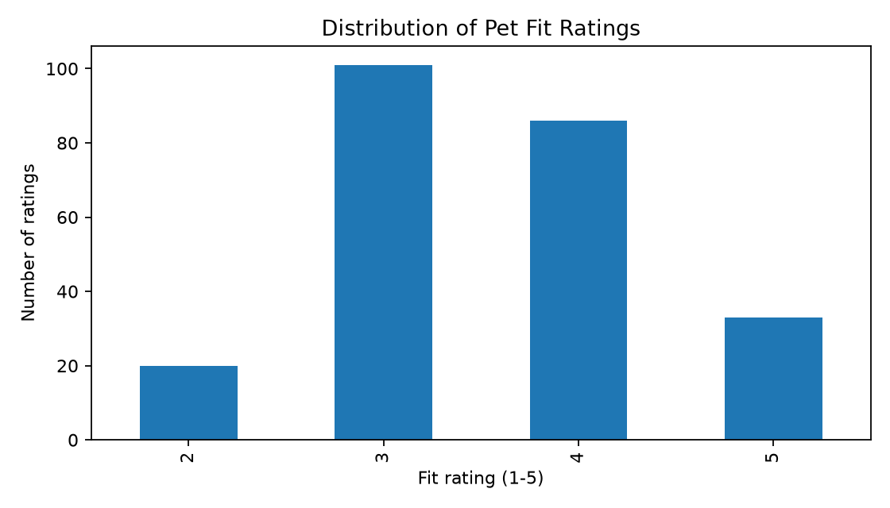
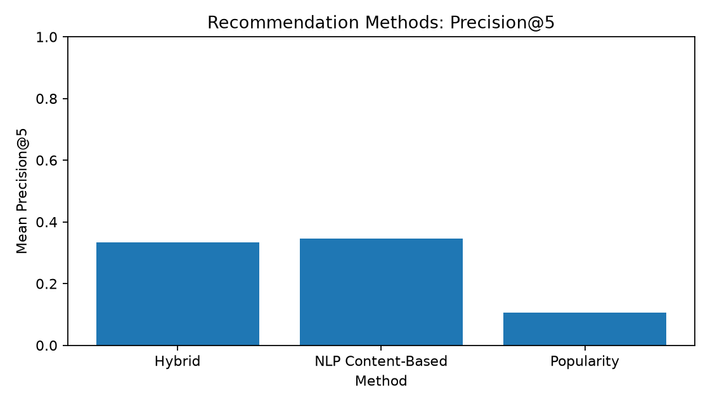

# Pet Adoption Profile and Owner Matcher

**Course:** CS467 Advanced Artificial Intelligence (2026-2027)  
**Student:** Võ Thị Khánh Ly  
**Student ID / Section:** 28211347593 / CS467C (No. 09)  
**Project Code:** MP-C09  
**Project Title:** Pet Adoption Profile and Owner Matcher

## 1. Problem Statement
Animal shelters write short personality profiles for rescued pets. This project uses Natural Language Processing (NLP) and recommendation methods to match a pet's temperament with an adopter's home lifestyle. The application supports free-text adopter queries, similar-pet discovery, and cold-start matching for a newly rescued pet.

## 2. Dataset
- `data/items.csv`: 40 pet profiles with `item_id`, `pet_name`, `species`, `age_group`, `personality_bio`, and `lifestyle_tags`.
- `data/ratings.csv`: 15 adopters and fit ratings (`user_id`, `item_id`, `fit_rating`, `shelter_note`). Each adopter rates 16 pets. This gives 240 observed ratings out of 600 possible user-item pairs (60% missing).
- Ratings are synthetic and created for this educational mini-project; they are not real adoption outcomes.

## 3. NLP Methods
1. Lowercase and clean text, remove punctuation/digits, normalize spaces.
2. Tokenize and remove English/custom stop words.
3. Combine each pet's personality bio and lifestyle tags.
4. Fit TF-IDF with unigrams/bigrams and transform new adopter queries using the same fitted vocabulary.
5. Compute cosine similarity between query and pet documents.
6. Extract overlapping terms as brief match explanations.

## 4. Recommendation Methods
- **Popularity Baseline:** rank pets by average fit rating, requiring at least two ratings; optionally exclude pets already rated by the target user.
- **NLP Content-Based:** rank pet profiles by TF-IDF cosine similarity for either a free-text query or a selected pet profile.
- **Item-Based Collaborative Filtering:** estimate compatibility from similarities between item rating vectors.
- **Hybrid Matcher:** combine normalized NLP similarity and item-based CF score: `0.65 * NLP + 0.35 * CF`. For cold-start pets, NLP remains available even when collaborative ratings do not exist.


## 5. Installation

Python 3.9 or higher is recommended.

### Step 1: Create virtual environment

```powershell
python -m venv venv
```

### Step 2: Activate virtual environment

Windows PowerShell:

```powershell
.\venv\Scripts\Activate.ps1
```

### Step 3: Install dependencies

```powershell
pip install -r requirements.txt
```


## 6. Run Commands
Run commands from the project root:

```bash
python -m src.main
python -m src.main --query "quiet apartment, first time owner, calm affectionate cat"
python -m src.main --query "active home, hiking, energetic dog" --user U002
python -m src.evaluate
```

The evaluation command writes two charts and CSV metrics to `results/`.

## 7. Required Test Cases
1. **Adopter query:** `"quiet apartment, first time owner, looking for calm affectionate cat"` returns the Top-5 matching profiles with similarity scores and keywords.
2. **Similar-profile test:** select `P001` (Milo) and retrieve the five closest temperament profiles.
3. **Cold-start test:** add rescued pet `P041` (Maple), which has zero ratings, then rank it using NLP similarity. The content-based model does not require historical ratings.

Run all three with `python -m src.main`.

## 8. Evaluation
The evaluation uses a per-user 80/20 holdout split. It reports Precision@5 for Popularity, NLP Content-Based, and Hybrid methods. It also reports RMSE and MAE for the item-based rating prediction proxy. Generated results:
- `results/rating_distribution.png`
- `results/precision_at_5_comparison.png`
- `results/evaluation_metrics.csv`
- `results/per_user_evaluation.csv`

Run `python -m src.evaluate` to regenerate them. Numerical values are data- and split-dependent; use the values printed by your local run in the final report.

## 9. Project Structure
```text
cs467-miniproject-28211347593/
├── README.md
├── requirements.txt
├── .gitignore
├── data/
│   ├── items.csv
│   └── ratings.csv
├── src/
│   ├── __init__.py
│   ├── nlp_pipeline.py
│   ├── recommender.py
│   ├── evaluate.py
│   └── main.py
├── notebooks/
└── results/
```

## 10. Reflection, Limitations, and Future Work
The combination of profile text and compatibility ratings provides both content-based and collaborative signals. NLP enables recommendations for new pets without ratings. Limitations include a small synthetic dataset, simple keyword-based explanations, and limited user feedback. A future version could use a larger real shelter dataset, richer adopter questionnaires, more robust ranking metrics, and human-reviewed adoption outcomes.

## 11. Academic Integrity
The dataset in this repository is synthetic and the implementation is written for this assigned scenario. Be prepared to explain text preprocessing, TF-IDF, cosine similarity, item-based collaborative filtering, the hybrid formula, evaluation split, and limitations during the project demonstration.

## 12. Sample Outputs

### Test Case 1 - Adopter Query

Query: "quiet apartment, first time owner, looking for calm affectionate cat"

Top 5 recommended pets:

| Item ID | Pet Name | Species | Similarity |
|---|---|---|---:|
| P001 | Milo | Cat | 0.395360 |
| P022 | Freya | Cat | 0.271943 |
| P033 | Pearl | Cat | 0.258054 |
| P004 | Coco | Cat | 0.155587 |
| P016 | Willow | Cat | 0.148963 |

### Test Case 1B - Hybrid Matcher

| Item ID | Pet Name | Species | Hybrid Score |
|---|---|---|---:|
| P006 | Daisy | Dog | 0.376979 |
| P005 | Rocky | Dog | 0.369773 |
| P031 | Marble | Rabbit | 0.369273 |
| P018 | Poppy | Guinea Pig | 0.365795 |
| P035 | Rosie | Dog | 0.364592 |

### Test Case 2 - Similar Pet Profiles

Selected pet: P001 - Milo

| Item ID | Pet Name | Similarity |
|---|---|---:|
| P033 | Pearl | 0.212772 |
| P012 | Cleo | 0.145464 |
| P016 | Willow | 0.115565 |
| P002 | Luna | 0.110166 |
| P004 | Coco | 0.106915 |

### Test Case 3 - Cold Start

New pet: P041 - New Rescue Maple

- Species: Cat
- Historical ratings: 0
- NLP similarity: 0.510784

The system successfully recommends a newly rescued pet without historical ratings using NLP content-based matching.

## 13. Evaluation Charts

### 13.1 Rating Distribution

The following chart shows the distribution of pet fit ratings in the dataset.



### 13.2 Precision@5 Comparison

This chart compares the recommendation performance of the three methods.


